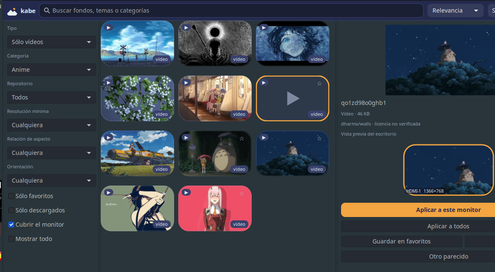
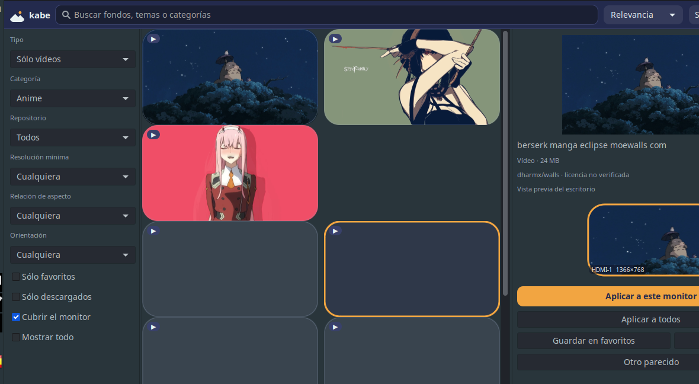

<p align="center">
  
</p>

<p align="center">
  <b>Python 3 · GTK3 · sin navegador embebido</b><br>
  <a href="https://github.com/kabe-app/kabe/releases"></a>
  <a href="https://github.com/kabe-app/kabe/actions"></a>
</p>

# Kabe (壁)

**Kabe** —*pared* en japonés— es un descubridor y aplicador de fondos de
pantalla para Linux..Indexa repositorios de GitHub sin clonarlos, busca en un
índice local tolerante a errores de tipeo y aplica el fondo en tu escritorio
real, con una vista previa de cómo quedará en cada monitor.

Ligero por diseño: Python 3 + GTK3, sin navegador embebido, sin Electron, sin
dependencias raras. Sirve para MX Linux XFCE, Debian, Ubuntu, Fedora, Arch,
Linux Mint y openSUSE, con X11 y con Wayland.

---

## Qué hace

- **Descubre** fondos en repositorios de GitHub (4K, 5K, ultrawide, HD) con
  una sola petición por repositorio mediante el API de *Git Trees*.
- **Busca** con tolerancia a errores de tipeo y a tildes, sobre un índice
  SQLite local con FTS5 (tokens + trigramas).
- **Filtra** por categoría, repositorio, resolución mínima, relación de
  aspecto, orientación, favoritos y descargados.
- **Detecta tus monitores** (resolución, refresco, escala, orientación y
  disposición) con `xrandr`, `wlr-randr`, `hyprctl`, `swaymsg`,
  `kscreen-doctor` o la información de GDK.
- **Aplica** el fondo en XFCE, GNOME, KDE Plasma, Cinnamon, MATE, LXQt, LXDE,
  Budgie y Deepin, además de `feh`, `nitrogen`, `swww`, `hyprpaper` y
  `swaybg`.
- **Vídeos de fondo**: indexa también los `.mp4`, `.webm`, `.mov`… de los
  repositorios y los aplica como fondo animado con `mpvpaper` (Sway) o
  `xwinwrap` + `mpv` (X11). La miniatura es un fotograma extraído con
  `ffmpeg` sin descargar el vídeo entero.
- **Previsualiza** el resultado sobre una maqueta de tu escritorio real, con
  las mismas esquinas redondeadas del logo.
- **Rota** los fondos automáticamente por intervalo o por hora del día, con
  bandeja del sistema y modo «sólo bandeja».

## Capturas

| Ventana principal | Vista previa multimonitor |
|---|---|
|  |  |

## Instalación

### Debian / Ubuntu / MX Linux (paquete .deb)

```sh
./packaging/build_deb.sh          # genera dist/kabe_<versión>_amd64.deb
sudo apt install ./dist/kabe_*_amd64.deb
```

### Cualquier distribución (instalador sencillo)

```sh
sudo ./packaging/install.sh       # instala en /usr/local
./packaging/install.sh --user     # instala en ~/.local (sin sudo)
```

### AppImage

```sh
./packaging/build_appimage.sh     # necesita appimagetool
```

### Flatpak (extra)

```sh
flatpak-builder --user --install build packaging/flatpak/io.github.kabe.Kabe.yaml
```

### Desde el código

```sh
python3 -m kabe
```

Dependencias: `python3` (≥ 3.8) y `python3-gi` + `gir1.2-gtk-3.0`, que ya
vienen instalados en XFCE, GNOME, Cinnamon, MATE, LXQt, KDE y demás.

## Uso

```sh
kabe                 # abre la aplicación
kabe --tray          # sólo en la bandeja del sistema
kabe --refresh       # actualiza el índice y sale
kabe --apply FOTO    # aplica una imagen local como fondo
kabe --search "anime" # abre con una búsqueda ya escrita
kabe --list-monitors # muestra los monitores detectados
```

Atajos dentro de la aplicación:

| Atajo | Acción |
|---|---|
| `Ctrl+F` | Ir al buscador |
| `Ctrl+R` | Actualizar el índice |
| `Ctrl+S` | Guardar en favoritos |
| `Ctrl+D` | Descargar |
| `Ctrl+Enter` | Aplicar al monitor seleccionado |
| `Ctrl+Shift+A` | Aplicar a todos los monitores |
| `Ctrl+N` | Sorpréndeme |
| `Esc` | Limpiar la búsqueda |

## Añadir repositorios

Desde el menú **Añadir repositorio** se pega la dirección del repo:

```
https://github.com/propietario/repositorio
```

Kabe comprueba la URL, guarda el repo en `~/.config/kabe/repos.json` y lo
indexa con el mismo mecanismo que los del catálogo. Para editar el catálogo
completo (propietario, rama, carpeta, licencia y etiquetas) está
[`kabe/repos.json`](kabe/repos.json).

Cada entrada indica si su licencia está verificada. Cuando no lo está, la
interfaz lo dice con claridad: **«licencia no verificada»**.

## Cómo funciona

```
kabe/
├── app.py            aplicación GTK, bandeja, rotación
├── db.py             índice SQLite con FTS5 (tokens + trigramas)
├── net.py            HTTP con ETag, token opcional y descargas cancelables
├── indexer.py        sincroniza repos.json con el índice
├── monitors.py       detección de monitores (xrandr, wlr-randr, hyprctl…)
├── probe.py          lee la cabecera de la imagen para saber su resolución
├── thumbs.py         miniaturas bajo demanda con caché en disco y LRU
├── rotation.py       rotación por intervalo o por hora
├── providers/        github.py (API de árbol) y local.py (carpetas)
├── wallpaper/        un aplicador por entorno + detección del escritorio
├── ui/               ventana, cuadrícula virtualizada, maqueta de monitores
└── repos.json        catálogo de repositorios
```

- **Sin clones.** Una petición por repositorio al API de *Git Trees*; la
  descarga de `raw.githubusercontent.com` sólo ocurre con el fondo que el
  usuario elige.
- **Cuota de la API.** Con ETag/`If-None-Match` y una caché en disco con
  caducidad configurable. Sin token: 60 peticiones por hora; con token
  personal (opcional, en Preferencias): 5000.
- **Miniaturas.** Se cargan sólo las visibles, reducidas a ~300 px con
  GdkPixbuf, con tope de 24 en memoria (LRU) y limpieza por antigüedad en
  disco.
- **Hilos.** Descargas, miniaturas, resolución e indexación ocurren fuera del
  hilo de GTK; la interfaz nunca se congela.

## Rutas y configuración

| Qué | Dónde |
|---|---|
| Configuración | `~/.config/kabe/config.json` |
| Repos del usuario | `~/.config/kabe/repos.json` |
| Índice y cachés | `~/.cache/kabe/` |
| Descargas | `~/.local/share/kabe/wallpapers/` |

## Identidad visual

Tres colores y ninguno más:

| | Color | Uso |
|---|---|---|
| Índigo | `#232A4D` | color principal, texto sobre claro |
| Neblina | `#E8F1F2` | superficies claras, texto sobre oscuro |
| Ámbar | `#F2A541` | acento único: botón principal y monitor activo |

El resto de la interfaz respeta el tema GTK del sistema (claro u oscuro); la
paleta de Kabe sólo se aplica a los elementos propios. El logo usa Inter con
alternativas Cantarell, Noto Sans y DejaVu Sans.

Iconos generados en `share/icons/hicolor/` (16, 24, 32, 48, 64, 128 y 256 px,
más el SVG escalable y el icono simbólico para la bandeja).

## Web

La web del proyecto está lista en `site/` (un único HTML con la paleta de
Kabe, la página de instalación y el favicon). Para publicarla:

```sh
python3 tools/build_site.py    # deja todo en dist/site/
```

`dist/site/` contiene el HTML, el favicon, las capturas y la carpeta
`descargas/` con el `.deb` y el `install.sh`. Se sube tal cual a cualquier
hosting estático (GitHub Pages, Netlify, un nginx…). `site/vercel.json` trae
la configuración para Vercel.

## Pruebas

```sh
python3 -m unittest discover -s tests -t . -v
```

Cubren la detección de monitores (con salidas simuladas de `xrandr`,
`wlr-randr`, `hyprctl`, `swaymsg` y `kscreen-doctor`), el índice y el
buscador, los aplicadores de fondo (con comandos simulados), el cliente HTTP
con ETag, el catálogo de repositorios, el contraste WCAG de la paleta y el
soporte de vídeos (filtro por tipo, metadatos y reproductores).

## Recursos

Medido en MX Linux XFCE (Python 3.13, GTK 3.24) con 5.419 fondos indexados:

| Modo | RSS total | Propio (anónimo) |
|---|---|---|
| Ventana abierta | ~93 MB | ~45 MB |
| Sólo bandeja | ~68 MB | ~25 MB |

Para poner las cifras en contexto: **un programa GTK3 vacío ya consume 62 MB
en este equipo** (40 MB de ellos son páginas de librerías compartidas con el
resto del escritorio). Kabe añade ~30 MB con la ventana abierta —miniaturas,
índice y widgets— y ~6 MB en modo bandeja. `python3 tools/measure.py` repite
la medición.

Decisiones que mantienen el consumo acotado:

- Miniaturas de 300 px en disco y un máximo de 24 vivas en RAM (LRU).
- Una sola miniatura se decodifica a la vez y la memoria se devuelve al
  sistema con `malloc_trim` (decodificar un PNG de 4K reserva ~70 MB).
- El índice SQLite se compacta (VACUUM) tras reconstruirse.
- El modo bandeja no crea ventana, ni índice, ni miniaturas.


## Licencia

GPL-3.0-or-later.
